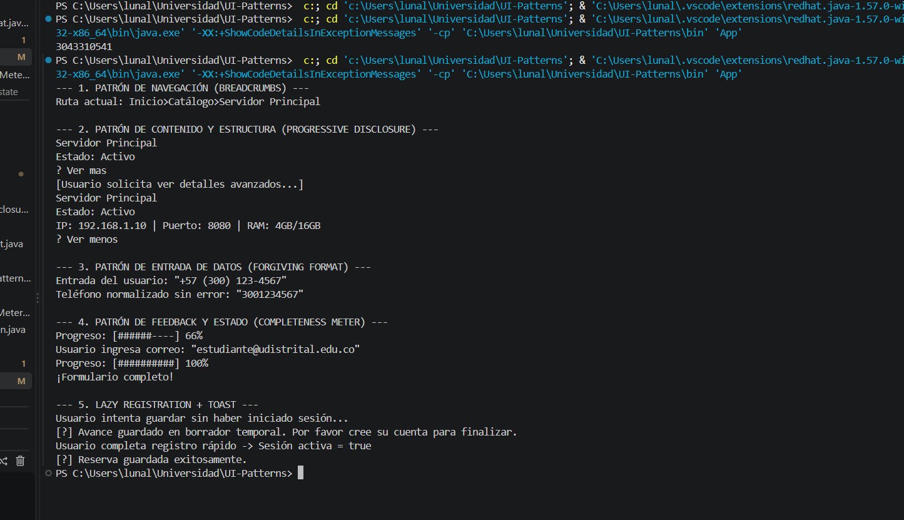

# University Reservation Portal - User Interface Patterns
> Introduction to User Interface Patterns in Java

## Description
The context of this project is a university reservation portal used from the console. Users need to know where they are, avoid being overwhelmed by information, type their data in the way that feels natural to them, understand how much of a form is left, and be asked to register only when it is really necessary.
The main goal is to implement five user interface patterns using only console logic: Breadcrumbs, Progressive Disclosure, Forgiving Format, Completeness Meter, and Lazy Registration with Toast. Each pattern keeps its state in an object and returns text through a `render`-style method, so the logic is separated from what is printed.
The `App` class runs a single flow that shows each pattern in order: navigating to a server, expanding its details, normalizing a phone number, completing a form, and saving a reservation as a guest before registering.

## Avoiding Dark Patterns
This implementation avoids Dark Patterns by never tricking or pressuring the user. Progressive Disclosure only hides advanced technical details behind a clearly labeled "Ver mas" control, and the user decides when to expand them. Forgiving Format accepts many phone formats instead of punishing the user with errors, and tells them when a number is not valid. Lazy Registration lets the user browse and keep their progress as a draft without forcing an account, and only asks them to register to finish. The Completeness Meter shows real progress without fake urgency, and every Toast reports exactly what happened, with no hidden or misleading messages.

# Project Structure
Package: navigation

* class BreadcrumbsPattern (Breadcrumbs navigation trail)

Package: content

* class ProgressiveDisclosure (Collapsible card with summary and details)

Package: input

* class ForgivenFormat (Phone number normalization and validation)

Package: state

* class CompletenessMeter (Form progress bar)
* class LazyRegistration (Guest or registered session)
* class Toast (Temporary feedback messages)

Package: main

* class App (Client)

# How to Run

1. Clone or download the repository.
2. Open the project in a Java-compatible IDE such as VS Code, IntelliJ IDEA, or Eclipse.
3. Make sure Java is correctly installed and configured.
4. Compile the sources, e.g. `javac -d bin src/navigation/*.java src/content/*.java src/input/*.java src/state/*.java src/main/*.java`.
5. Run `main.App` to see the five patterns working in sequence.
6. Check the console output to verify the breadcrumb trail, the expandable card, the normalized phone number, the progress bar, and the final toast.

# Console Output

Last Modification: 25/10/2026